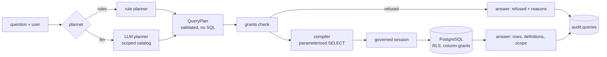

# Architecture

## The question pipeline



1. **Plan.** A planner turns the question into a `QueryPlan`: metrics, dimensions, an optional
   time grain, filters, a time range, an order and a limit. Names refer to the semantic layer and
   values are data. The schema forbids unknown keys, so a plan cannot carry SQL.
2. **Check.** Every metric, dimension and filter field must exist in the semantic layer and be
   granted to one of the user's roles. Dimensions classified `pii` also need a role with
   `pii: true`. Filters count: filtering revenue by a customer's name reveals that customer's
   revenue, so it needs the same access as showing the name. All reasons are collected, not
   just the first.
3. **Compile.** Identifiers come only from the semantic layer and are quoted with
   `psycopg.sql`. Values, including the semantic layer's own filter values, are bound
   parameters. Each measure carries its definition as an aggregate `FILTER (WHERE ...)`, so two
   measures with different definitions can sit in one query. Joins are the shortest path in the
   join graph from the measure's entity to each entity the plan uses. A filter that contradicts a
   measure's definition (orders, which excludes cancelled, filtered to cancelled) is an error, not
   a silent zero. Results are ordered deterministically and capped.
4. **Run.** See below.
5. **Explain.** The answer restates the plan, gives the definition of every measure used, and says
   when the user's region scope limited the rows.
6. **Audit.** Every question is written to `audit.queries` with the user, planner, outcome,
   reasons, plan, SQL, parameters, row count and duration, whether it was answered or not.

## The governed session

```mermaid
sequenceDiagram
    participant S as service (login gda_app)
    participant PG as PostgreSQL
    S->>PG: BEGIN; SET TRANSACTION READ ONLY
    S->>PG: SET LOCAL ROLE gda_reader (or gda_reader_pii)
    S->>PG: set_config('gda.regions', 'EMEA', true)
    S->>PG: set_config('statement_timeout', '5000', true)
    S->>PG: SELECT ... (one statement, parameters bound)
    PG-->>S: rows visible under the region policy and column grants
    S->>PG: ROLLBACK
```

- `gda_app` is granted the reader roles `WITH INHERIT FALSE, SET TRUE` (PostgreSQL 16+). It can
  switch to them and has none of their privileges until it does.
- `gda_reader` has `SELECT` on every mart column except those the dbt model lists as PII.
  `gda_reader_pii` has `SELECT` on all of them.
- The marts with a `region` column have a policy for both reader roles:
  `region = any(string_to_array(current_setting('gda.regions', true), ','))`. With the setting
  absent the expression is null and no row is visible.
- All settings are transaction-local and end with the rollback.

## The warehouse

```
seeds (raw.*)  ─▶  staging views (staging.*)  ─▶  marts (marts.*)
                    types, cleaning                fct_order_lines  one row per order line, region from the customer
                    not readable by readers         dim_customers    region policy; name, email, phone are PII
                                                    dim_products     no policy
```

Each mart's post-hook calls `govern(row_policy=..., pii=[...])`, which grants columns, enables
row-level security and creates the policy on the freshly built table. A singular dbt test
(`assert_marts_are_governed`) fails the build if any mart with a region column lacks row-level
security or if `gda_reader` holds a privilege on a PII column.

## The LLM planner

The system prompt contains the plan's JSON schema, today's date and the catalog visible to the
user: measures, dimensions, values and grains they may use, nothing else. The question is sent
as `{"question": "..."}`. The reply must be `{"plan": ...}` or `{"unsupported": "..."}`; anything
else is rejected with the validation error and retried once. The planner never sees data.
